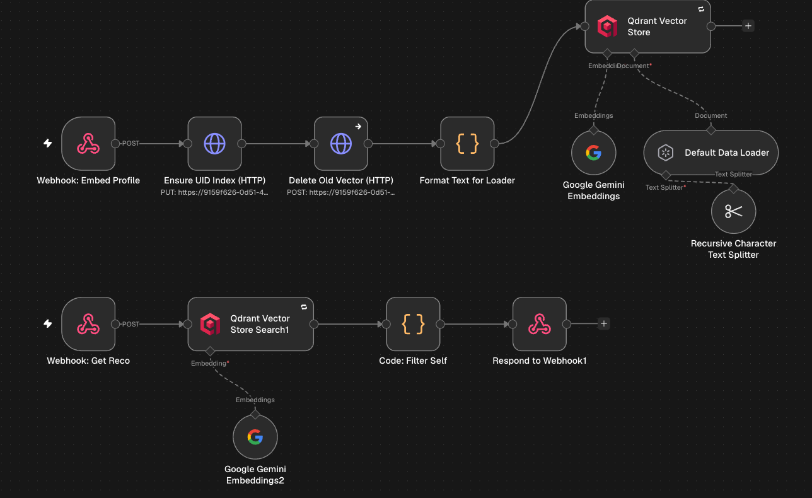
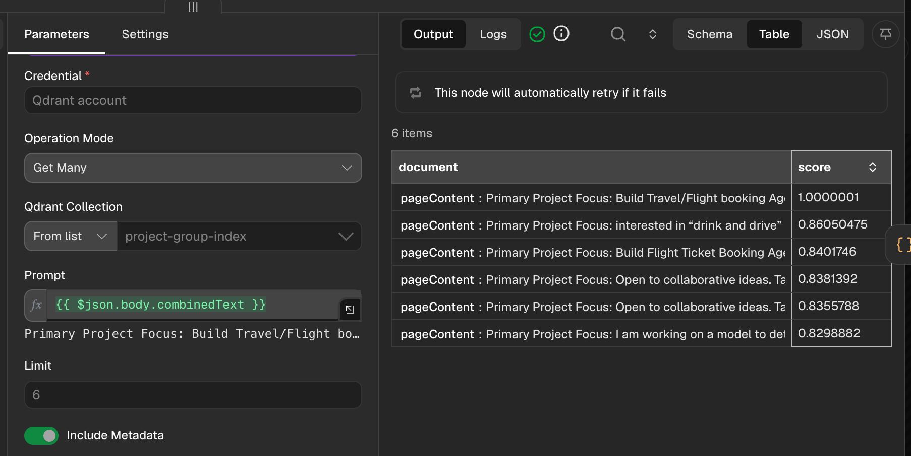

# 🚀 Project Group RecSys

**Project Group RecSys** is an AI-powered student and learner teaming platform designed to help cohort members discover compatible teammates based on project ideas, target domains, and professional backgrounds. 

Built with a lightweight static frontend, **Firebase (Authentication & Firestore)** for secure real-time data management, **n8n** for AI orchestration, **Google Gemini Embeddings** for semantic understanding, and **Qdrant** as the vector similarity engine.

---

## ✨ Key Features

- **🔐 Secure Username/Password Authentication**: Powered by Firebase Authentication using a zero-email synthetic domain pattern (`<username>@recsys.local`), backed by Firestore Security Rules and Admin Custom Claims.
- **🤖 AI Semantic Recommendations**: Uses hierarchical vector weighting (`Project Idea` > `Project Domain` > `Work Domain` > `Background` > `Location` > `Experience`) to prevent location/experience feature domination and match learners with aligned project goals.
- **🔍 Instant Multi-Field Member Search**: In-memory filtering across Name/Username, Experience, City, Background, Work Domain, Project Domain, and Status (`open`, `solo`, `teamed_up`). Automatically sorts members with defined project ideas or domains to the top.
- **🤝 Team Formation & Interest Workflow**:
  - Send, accept, and reject teaming interests with real-time notification badges.
  - Manual **"Build Your Team"** selector in the Profile tab when switching status to `teamed_up` (enforces minimum 1 teammate and dynamic max capacity).
  - Cascading team dissolution logic when members leave a group.
- **📋 Simplified Projects Showcase**: Displays finalized project groups with sequential numbering (`Group 1`, `Group 2`, ...), member rosters, and multiline editable project descriptions.
- **🛡️ Admin Dashboard**:
  - Generate random match rounds (5 random open peers per learner).
  - Configure `Max Members per Group`.
  - Toggle `Allow New Registrations` and `Load Autocomplete Pre-Login` dynamically via Firestore (`settings/config`).

---

## 🏗️ System Architecture

```text
[Static Frontend (HTML/JS)]
       │
       ├──► Firebase Auth (Username/Password via synthetic email)
       ├──► Cloud Firestore (users, user_directory, projects, settings/config)
       │
       └──► n8n Webhooks
               ├──► /webhook/embed-profile       ──► Gemini Embeddings ──► Qdrant (Delete & Insert)
               └──► /webhook/get-recommendations ──► Gemini Embeddings ──► Qdrant (Top-K Cosine Search)
```

---

## ⚙️ n8n AI Workflow Architecture

The AI recommendation engine is orchestrated through two webhook-driven pipelines inside **n8n**, connected to **Google Gemini Embeddings** and **Qdrant Cloud** (`project-group-index` collection).



### 1. Profile Embedding & Sync Pipeline (`Webhook: Embed Profile`)
Triggered whenever a user registers, updates their profile, forms a team, or during bulk Python syncing:
1. **Webhook: Embed Profile (`POST`)**: Receives `{ uid, combinedText, status }` from the frontend or Python sync script.
2. **Ensure UID Index (`HTTP PUT`)**: Ensures a payload index exists on the `uid` metadata field in Qdrant for fast filtering and deletion.
3. **Delete Old Vector (`HTTP POST`)**: Removes any existing vector associated with the user's `uid` before re-inserting. This guarantees strict 1:1 parity per user and prevents duplicate "ghost" vectors when a user edits their profile or changes status.
4. **Format Text for Loader (`Code`)**: Prepares the hierarchically weighted `combinedText` and attaches `uid` and `status` metadata.
5. **Qdrant Vector Store (`Insert`)**: Uses **Google Gemini Embeddings** along with the **Default Data Loader** and **Recursive Character Text Splitter** to vectorize the profile and store it in the `project-group-index` collection.

### 2. AI Recommendation Retrieval Pipeline (`Webhook: Get Reco`)
Triggered on-demand when an **Open** learner opens the **AI Recos** tab or clicks **Refresh Matches**:
1. **Webhook: Get Reco (`POST`)**: Receives the current user's `uid` and hierarchically weighted `combinedText`.
2. **Qdrant Vector Store Search (`Get Many`)**: Embeds the query prompt using **Google Gemini Embeddings** and runs a Cosine similarity search against `project-group-index`.
3. **Code: Filter Self**: Strips out the requesting user's own profile (which naturally scores `~1.0` similarity) and returns the ranked list of top matching UIDs.
4. **Respond to Webhook**: Sends the sorted candidate UIDs back to the frontend, where `js/app.js` fetches their latest Firestore profiles and preserves Qdrant's highest-to-lowest similarity ranking.

#### Top-K Similarity Retrieval Details
As shown below, the Qdrant search node queries `{{ $json.body.combinedText }}` with **Limit = 6** and **Include Metadata** enabled:



- **Why Limit = 6?** The top result (`score: 1.0000001`) is always the querying user's own vector. Fetching 6 items ensures that after `Code: Filter Self` removes the user's own record, up to **5 top-ranked peers** remain to be displayed in the UI.
- **Hierarchical Prompting**: Because every vector starts with `Primary Project Focus: ...`, learners with concrete project ideas (e.g., *"Build Travel/Flight booking Agent"*) surface at the top of the similarity table ahead of location or experience matches.

---

## 📂 Repository Structure

```text
.
├── index.html                    # Single-page UI (Auth, Profile, Search, Projects, Admin)
├── js/
│   └── app.js                    # Firebase Auth, Firestore CRUD, Filtering, & Webhook calls
├── scripts/
│   ├── bulk_register.py          # Bulk-import learners from CSV into Firestore & Qdrant
│   ├── sync_firestore_to_qdrant.py # Re-embed all existing Firestore users into Qdrant
│   └── migrate_to_firebase_auth.py # One-time migration of SHA-256 users to Firebase Auth
├── n8n_workflow.png              # n8n dual-pipeline architecture diagram
├── n8n_retrieval_topk.png        # Qdrant Top-K retrieval configuration & sample output
└── README.md
```

---

## 🛠️ Setup & Deployment

### 1. Firebase Setup
1. Create a Firebase project and enable **Cloud Firestore** and **Authentication (Email/Password)**.
2. Update `firebaseConfig` in `js/app.js` with your project credentials.
3. Deploy the Firestore Security Rules to protect `users` and `projects` behind `request.auth != null`, while keeping `settings/config` and `user_directory` readable pre-login.
4. Create the initial configuration document in Firestore at `settings/config`:
   ```json
   {
     "maxMembers": 2,
     "register_allowed": true,
     "load_autocomplete_prelogin": true
   }
   ```

### 2. Qdrant & n8n Setup
1. Create a collection named `project-group-index` in **Qdrant Cloud** using **Cosine** distance (match vector dimensions to your configured Gemini embedding model, e.g., `768` for `embedding-001` or `3072` if configured for 3072-dim output).
2. Import the n8n workflow, attach your **Qdrant** and **Google Gemini** credentials, and activate the workflow.
3. Update `WEBHOOK_EMBED_PROFILE` and `WEBHOOK_GET_RECO` in `js/app.js` with your production n8n webhook URLs.

### 3. Python Admin & Sync Scripts
Install dependencies:
```bash
pip install firebase-admin requests
```
Place your Firebase Admin `serviceAccountKey.json` in the project root (do **not** commit this file to Git).

- **Sync Firestore profiles to Qdrant**:
  ```bash
  python sync_firestore_to_qdrant.py
  ```
- **Migrate legacy SHA-256 Firestore users to Firebase Auth**:
  ```bash
  python migrate_to_firebase_auth.py
  ```

> **Tip:** The Python scripts set `os.environ["GRPC_DNS_RESOLVER"] = "native"` at startup to prevent `503 DNS query cancelled` errors in Python's Firestore gRPC client.

---

## 🔒 Security Highlights

- **No password hashes in Firestore**: Credentials are managed exclusively by Firebase Authentication (`scrypt` + per-user salts + built-in rate limiting).
- **Pre-login privacy**: The public `user_directory` collection exposes only `{ username, name }` when pre-login autocomplete is enabled, keeping contact details, LinkedIn URLs, and project ideas strictly behind authentication.
- **Role protection**: Admin actions (`settings/config` writes and random match generation) are gated by Firebase Auth Custom Claims (`admin: true`).